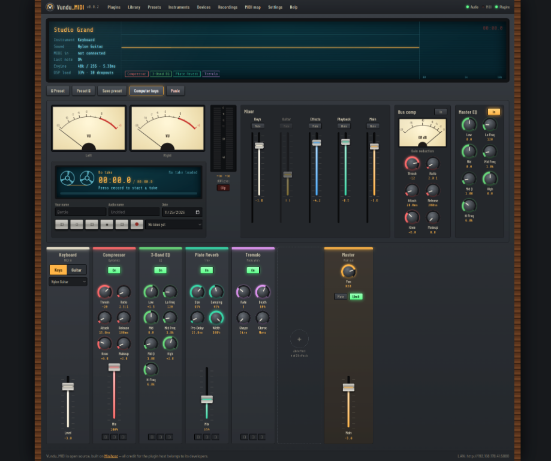

# Vundu_MIDI           [](https://deepwiki.com/MindFarter/Vundu_MIDI) 

**v0.0.2** · A studio mixing-console for your MIDI keyboard or guitar, running in
the browser.

Project by [MindFarter](https://github.com/MindFarter).



Vundu_MIDI is a local server. Plug a 5-pin DIN MIDI to USB cable into your
computer, choose your instrument (keyboard or guitar), choose an effect or a
preset, and play. The sound comes out of the computer's speakers, or out of its
audio jack into a hi-fi or guitar amplifier with a 3.5 mm to RCA lead. Press
Record to capture what you play, effects and all.

The interface is modelled on an analogue recording desk: a glass screen with
the waveform and spectrum at the top; below it back-lit VU meters with a tape
deck for recording and playback, a dB peak meter, a mini mixer, the bus
compressor and the master EQ; then a row of channel strips with light-up knobs
and faders, one strip per effect (up to 20).

It runs on Linux, Raspberry Pi OS (Trixie) on a Raspberry Pi 5, macOS and
Windows, and everything it does is also available through a REST API so an
ESP32 can be turned into a MIDI interface for it later.

- - -
## Built on Minihost

> **Vundu_MIDI is an open source app based on the open source software 
> [Minihost](https://github.com/shakfu/minihost).** All attribution for Minihost
> belongs to its developers (Minihost is created and maintained by Shakeeb
> Alireza and contributors). Vundu_MIDI uses Minihost to load and run VST3, LV2,
> CLAP and AudioUnit plugins, to scan for plugins and to read USB MIDI ports.
> Please star and support the Minihost project.

Because Minihost is licensed under the GNU GPL v3, Vundu_MIDI is released under
the **GNU GPL v3 or later** as well (see [LICENSE](LICENSE)).

- - -
## Contents

- [Features](#features)
- [What you need](#what-you-need)
- [Quick start](#quick-start)
  - [One-time system setup](#one-time-system-setup-recommended)
  - 
    [Raspberry Pi 5 (Raspberry Pi OS Trixie)](#raspberry-pi-5-raspberry-pi-os-trixie)
- [Start the server](#start-the-server)
- [How to use: step by step](#how-to-use-step-by-step)
- [Using the console](#using-the-console)
- [Connecting your instrument](#connecting-your-instrument)
- 
  [Sending sound to a hi-fi or guitar amp](#sending-sound-to-a-hi-fi-or-guitar-amp)
- [Plugins](#plugins)
- [Presets](#presets)
- [Recording](#recording)
- [MIDI controls and MIDI learn](#midi-controls-and-midi-learn)
- [API](#api)
- [ESP32 MIDI interface (coming)](#esp32-midi-interface-coming)
- [Project layout](#project-layout)
- [Troubleshooting](#troubleshooting)
- [Contributing](#contributing)
- [Licence and credits](#licence-and-credits)

- - -
## Features

- **Studio console GUI** in any browser on your network (computer, tablet or
  phone)
  - Glass screen: preset, instrument, sound, MIDI device, notes being played,
    DSP load, scrolling waveform (turns red while recording), oscilloscope and
    spectrum analyser
  - Two back-lit analogue **VU meters** with real VU ballistics (0 VU = -18 dBFS)
  - **dB peak meter** with peak hold and a clip light
  - **Bus compressor** with its own gain-reduction needle meter, and a **master EQ**
  - Channel strips with colour caps, LED-ring knobs and light-up faders, one
    per effect
  - Master strip with pan, mute, limiter and the main fader
- **Instruments**: Keyboard (MIDI) or Guitar (guitar jack into an audio input, or
  a MIDI guitar)
- **USB MIDI** with hot-plug: the cable is found and connected automatically
- **10 built-in sounds**: grand piano, electric piano, tonewheel organ, string
  ensemble, warm pad, analog lead, synth bass, clean electric guitar, nylon
  guitar, crystal bells
- **11 built-in effects**: noise gate, compressor, overdrive, distortion, amp and
  cab, 3-band EQ, chorus, tremolo, tape delay, plate reverb, gain/pan
- **Plugins** through Minihost: VST3, LV2, CLAP (and AudioUnit on macOS), as
  effects or as sounds
- **12 factory presets**, plus your own presets
- **Recording** to 24-bit WAV, tagged with name, audio name and date, played back
  on the deck
- **MIDI learn**, sustain pedal, pitch bend, Program Change to switch presets
- **REST API** for everything, plus a live meter stream and MIDI over the network
  (UDP and HTTP)

## What you need

- A computer: Linux, Raspberry Pi 5 with Raspberry Pi OS (Trixie), macOS or
  Windows
- **Python 3.12 or newer** (already on Ubuntu 24.04+ and Raspberry Pi OS Trixie)
  and an internet connection for the first run
- A **5-pin DIN MIDI to USB cable** (or a USB MIDI keyboard) for MIDI instruments
- For a guitar played through effects: an **audio input** (line-in, or a USB
  audio interface)
- Speakers, headphones, or a **3.5 mm to RCA lead** into a hi-fi or guitar
  amplifier

## Quick start

```bash
cd ~/Projects                      # or wherever you keep projects
unzip Vundu_MIDI-0.0.2.zip         # or: git clone https://github.com/MindFarter/Vundu_MIDI.git
cd Vundu_MIDI
python3 vundu_midi.py
```
Then open **http://localhost:5080**.

That is the whole procedure. `python3 vundu_midi.py` is the only command you
ever need:

- **First run**: it creates its own private Python environment (a `.venv` folder
  inside `Vundu_MIDI`) and installs everything it needs. This takes a minute or
  two and needs internet.
- **Every run after that**: it checks the environment and starts straight away.
- **If anything is wrong** (the `.venv` folder is missing, damaged, or `
  requirements.txt` changed after an update) it repairs it by itself.

You never need to create or activate a virtual environment. It does not matter
which folder you put Vundu_MIDI in, or which folder you start it from.

### One-time system setup (recommended)

Python cannot install the computer's sound and MIDI libraries, so run this once
on each machine:

**Ubuntu / Debian / Raspberry Pi OS**

```bash
./scripts/install.sh
```
It installs `python3-venv`, PortAudio and the ALSA libraries, adds you to the `
audio` group (log out and back in once afterwards) and prepares Vundu_MIDI. If
you skip it and something is missing, Vundu_MIDI tells you the exact command to
run. Without PortAudio the console still opens, but there is no sound until you
install it (`sudo apt install libportaudio2`).

Extra options: `./scripts/install.sh --service` starts Vundu_MIDI automatically
at boot, and `./scripts/install.sh --with-minihost` builds Minihost on ARM
computers (see below).

**macOS**: `brew install portaudio` (optional; Python's audio package usually
includes it).

**Windows**: install Python 3.12 or newer from python.org (tick "Add python.exe
to PATH"), then in the Vundu_MIDI folder run `py vundu_midi.py`. Nothing else is
needed.

### Raspberry Pi 5 (Raspberry Pi OS Trixie)

Same steps as above. Two Pi-specific points:

- **Plugins**: Minihost does not publish ready-made packages for ARM Linux yet.
  Until it is built, Vundu_MIDI runs with all its built-in sounds and effects.
  To add VST3/LV2/CLAP plugin support, run `./scripts/install.sh --with-minihost`
  (it downloads and compiles Minihost: 20-40 minutes). LV2 plugins for the Pi
  come from the package manager, for example `sudo apt install x42-plugins
  calf-plugins guitarix-lv2 dragonfly-reverb-lv2`; then press **Plugins → Scan
  for plugins** in the console.
- **Sound output**: the Pi 5 has no 3.5 mm audio jack. For a hi-fi or amp use a
  small USB audio adapter (it also gives you a line/mic input for guitar) or
  HDMI audio. A buffer of 128 or 256 samples in **Devices** gives low latency.

## Start the server

```bash
python3 vundu_midi.py
```
Open **http://localhost:5080**, or from another device on your network the LAN
address printed at start-up. Stop it with **Ctrl+C**.


|Option                |Meaning                                                              |
|----------------------|---------------------------------------------------------------------|
|`\--port 8080`        |Web and API port (default 5080)                                      |
|`\--host 127.0.0.1`   |Only allow this computer (default: whole local network)              |
|`\--udp-port 5005`    |UDP MIDI port for the ESP32 (0 turns it off)                         |
|`\--output 3` / `\--input 2`|Audio device index or part of its name                               |
|`\--sample-rate 48000`|44100, 48000 or 96000                                                |
|`\--block-size 256`   |Audio buffer: lower means less delay but more CPU                    |
|`\--data ~/vundu-data`|Where settings, your presets and recordings are kept (default `./data`)|
|`\--list-devices`     |Show audio and MIDI devices and exit                                 |
|`\--no-audio`         |Run the console without opening a sound card                         |
|`\--reinstall`        |Delete and rebuild the Python environment from scratch               |
|`\--setup-only`       |Prepare the Python environment, then exit                            |
|`\--debug`            |Verbose log                                                          |

**Updating to a new version**: replace the files (unzip over the folder, or `git
pull`) and run `python3 vundu_midi.py`. Your settings, presets and recordings in `
data/` are kept, and the environment updates itself if the requirements changed.

## How to use: step by step

A complete session, from switching on to a finished recording. Each step links
to more detail.

1.  **Start Vundu_MIDI.** In the `Vundu_MIDI` folder run `python3 vundu_midi.py`
    and open **http://localhost:5080** (or the LAN address it prints, from a
    tablet or phone). See [Start the server](#start-the-server).
2.  **Check the three lights** at the top right. *Audio* green means sound will
    play. *MIDI* turns green when your cable or keyboard is connected. *Plugins*
    green means Minihost is ready (amber is fine: the built-in effects still
    work).
3.  **Connect your instrument.** Plug in the 5-pin DIN to USB cable (or a USB
    MIDI keyboard). It is picked up within two seconds and its name appears on
    the screen. For a guitar played through the effects, plug the guitar into
    an audio input instead. See 
    [Connecting your instrument](#connecting-your-instrument).
4.  **Choose the instrument.** On the first channel strip press **Keys** or **
    Guitar** (or open **Instruments** in the menu). For a guitar choose **Jack**
    (audio input) or **MIDI** (MIDI guitar pickup). For MIDI instruments pick a
    sound in the drop-down list.
5.  **Pick a sound or build one.**
  - Load a ready-made sound: **Presets** in the menu, or **◀ Preset** / **Preset ▶**
    .
  - Or build your own: open **Plugins** and click effects to add them (up to 20).
    Each one becomes a channel strip. Turn its knobs, switch it **On**/off, move
    it with **◀** / **▶** or remove it with **✕** (these three small buttons are
    at the bottom of each strip).
6.  **Set the levels.** Play and watch the VU and peak meters. Use the **Mixer**
    faders (Keys or Guitar, Effects, Main) so the peak meter stays out of the
    red and the **Clip** light stays off. The bus compressor and master EQ shape
    the overall sound.
7.  **Save it.** **Save preset** (or **Presets** in the menu), give it a name and
    category. A MIDI foot controller can switch presets with Program Change
    messages.
8.  **Record.** On the tape deck under the VU meters, fill in **Your name**, **
    Audio name** and the **Date**, then press **●**. **❚❚** pauses, **●**
    continues, **■** finishes the take. See [Recording](#recording).
9.  **Listen back.** Press **▶** on the deck. Use **◀◀** / **▶▶** to wind, or
    click the position bar. Earlier takes are in **Load a take…** and in the **
    Recordings** panel, where you can also download or delete them.
10. **Send it to an amp** (optional). Plug a 3.5 mm to RCA lead from the computer
    into a hi-fi or amp and choose that output in **Devices**. See 
    [Sending sound to a hi-fi or guitar amp](#sending-sound-to-a-hi-fi-or-guitar-amp)
    .
11. **Map your controller** (optional). **MIDI map → Learn**, click a knob or
    fader on screen, then move a knob on your MIDI device. See 
    [MIDI controls and MIDI learn](#midi-controls-and-midi-learn).
12. **Finish.** Press **Ctrl+C** in the terminal. Settings, presets and
    recordings are kept in `data/`.

If anything does not behave as expected, see [Troubleshooting](#troubleshooting)
.

## Using the console

**Menu bar.** Plugins (add effects, scan for plugins), Library (sounds, presets,
recordings), Presets, Instruments, Devices (MIDI and audio), Recordings, MIDI
map, Settings and Help. The three lights on the right show whether audio, the
MIDI interface and the plugin host are ready.

**Screen.** The current preset, instrument and sound, the MIDI device, the notes
you are playing, the audio engine and its DSP load. The waveform scrolls from
right to left and turns red while recording. The spectrum analyser sits on the
right, with the recording clock above it.

**Transport bar.** Previous and next preset, Save preset, Computer keys (play
notes from the computer keyboard: `A W S E D F T G Y H U J K`, `Z`/`X` change
octave) and Panic (stops all notes).

**Meter bridge**, from left to right:

- **VU meters** (left and right) with the **tape deck** underneath. See 
  [Recording](#recording).
- **Peak meter** in dBFS with peak hold, and the clip light (click to reset).
- **Mixer**: five channels, each with a level meter, a fader and a Mute button.
  - *Keys* \- level of the MIDI instrument (keyboard, or guitar in MIDI mode)
  - *Guitar* \- gain of the audio input (guitar in jack mode)
  - *Effects* \- output level of the whole effects chain; Mute bypasses every
    effect at once
  - *Playback* \- level of the tape deck when playing a take
  - *Main* \- the main output (the same control as the Master strip's fader)

    The channel your current instrument does not use is dimmed.

- **Bus compressor** with its gain-reduction meter, and the **Master EQ**. Press **
  In** to switch either in or out.

**Channel strips.** From left to right: your instrument, then one strip per
effect in the order the sound flows through them (up to 20; the desk scrolls
sideways), an empty strip to add an effect that shows how many slots are used,
and the Master strip.

- Drag a knob up or down; hold **Shift** for fine control. Mouse wheel and arrow
  keys work too.
- **Double-click** any knob or fader to reset it.
- **On** switches an effect in or out; the strip dims when it is bypassed.
- At the bottom of each effect strip, `◀` and `▶` move the effect earlier or
  later in the chain and `✕` removes it. Plugin strips also have **Edit** there,
  for every parameter and the plugin's own programs.

## Connecting your instrument

1.  Connect the cable: the end marked **IN** on the cable goes to your
    instrument's **MIDI OUT** socket (most cables are labelled from the
    computer's point of view, so if nothing happens, swap the two DIN plugs).
2.  Plug the USB end into the computer. Within two seconds the MIDI light turns
    green and the screen shows the cable's name. You can also pick it in **Devices**
    , which has a live MIDI monitor.
3.  Open **Instruments**:
  - **Keyboard** \- notes play the chosen sound, then go through the effects.
  - **Guitar, jack mode** \- plug the guitar into a line/instrument input or USB
    audio interface; the live signal goes through the effects. Choose the input
    channel in **Devices**. (A 5-pin MIDI cable cannot carry a guitar's sound,
    only MIDI messages.)
  - **Guitar, MIDI mode** \- for a MIDI guitar or hex pickup on the DIN cable;
    notes play the chosen sound (clean or nylon guitar by default).
4.  Pick a preset (or build your own chain) and play.

## Sending sound to a hi-fi or guitar amp

Sound plays through the system's default output. To use an amplifier, plug a 
**3.5 mm stereo jack to 2 × RCA** lead into the computer's headphone/line output
and the RCA plugs into the amp's AUX/line input. Choose that output in **Devices**
if it is not the default. For a guitar amp use its **effects return / power-amp in**
if it has one, keep the console's Main fader low to start with, and turn up
slowly: a line-level signal into a guitar input can be very loud.

## Plugins

Open **Plugins → Scan for plugins**. Minihost looks in the standard folders for
your system (shown at the bottom of the panel; add more in `data/config.json`
under `plugin_dirs`) and lists:

- **Effect plugins**: click one to add it to the chain as a new strip.
- **Instrument plugins** (synths, samplers): they appear as sounds in **
  Instruments** and **Library**.

Scanning runs each plugin in a separate process, so a plugin that crashes
during the scan is skipped rather than stopping the server. A plugin that fails
while playing is switched off and the rest keeps running. Plugin settings are
saved inside presets.

## Presets

A chain, and therefore a preset, can hold up to **20 effects**. Watch the DSP
load on the screen: if it goes above about 70% or you hear crackles, raise the
buffer size in **Devices** (256 → 512), especially on a Raspberry Pi.

Factory presets live in `presets/factory/` (keyboard, synth and guitar sounds).
Save your own from **Presets** or the **Save preset** button; they are stored in `
data/presets/` as readable JSON. A MIDI **Program Change** message selects
presets by number, so a MIDI foot controller can switch sounds while you play.

## Recording

The tape deck sits under the VU meters.

1.  Type **Your name**, the **Audio name** (the song or take) and check the **Date**
    (today by default).
2.  Press **●** (record). The reels turn, the counter runs and the waveform on
    the screen turns red.
3.  **❚❚** pauses the recording and **●** carries on in the same take. **■**
    finishes it.
4.  The finished take is loaded into the deck straight away: press **▶** to
    listen.
5.  While playing: **❚❚** pauses, **■** stops and returns to the start, **◀◀** / **
    ▶▶** rewind and fast forward 5 seconds per click (hold the button to keep
    winding), and clicking the position bar jumps to that point.
6.  **Load a take** lists every recording; pick one to play it on the deck.

Takes are 24-bit stereo WAV files in `data/recordings/`, named `
date_name_audio-name.wav`, with your name, the audio name and the date stored
inside the file as standard tags (artist, title, date). Everything you hear is
recorded: instrument, effects and the master section. Playback goes through the
Main fader, so you hear it on the same speakers or amp. The **Recordings** panel
lets you play, download or delete takes.

## MIDI controls and MIDI learn

Always active: sustain pedal (CC 64), pitch bend, All Notes Off, and Program
Change for presets. By default CC 7 controls the Main fader and CC 11 the
instrument level.

To map a knob on your controller: **MIDI map → Learn**, click a knob or fader on
screen, then move the control on your MIDI device. Mapped controls show a small
dot after their name. Mappings are saved.

## API

Everything the console does is available over HTTP. Responses are JSON with 
`"ok": true` or an `"error"` message. Full reference: [docs/API.md](docs/API.md)
. A live list of endpoints is at `GET /api/v1`.

```bash
# what is going on
curl http://localhost:5080/api/v1/status

# load a preset
curl -X POST localhost:5080/api/v1/presets/load -H 'Content-Type: application/json' \
     -d '{"id":"factory:blues_crunch"}'

# play a note
curl -X POST localhost:5080/api/v1/midi/send -H 'Content-Type: application/json' \
     -d '{"type":"note_on","note":60,"velocity":100}'

# add a delay and turn up its mix
curl -X POST localhost:5080/api/v1/chain -H 'Content-Type: application/json' -d '{"type":"delay"}'
```
## ESP32 MIDI interface (coming)

The server is ready for an ESP32 that reads a 5-pin DIN MIDI socket and sends
the messages over Wi-Fi:

- **UDP port 5005**: raw MIDI bytes per datagram (e.g. `90 3C 64`), lowest
  latency.
- **HTTP** `POST /api/v1/midi/send` with JSON messages.
- **HTTP** `POST /api/v1/remote/hello` to register the board; it appears in `GET
  /api/v1/status`.

Details and a sketch outline are in [docs/ESP32.md](docs/ESP32.md).

## Project layout

```
Vundu_MIDI/
├── vundu_midi.py          start here: python3 vundu_midi.py
├── vundu/
│   ├── bootstrap.py       first-run self-setup of the Python environment (.venv)
│   ├── server.py          builds the Flask app and starts the services
│   ├── api.py             REST API v1
│   ├── engine.py          real-time audio engine, mixer, meters
│   ├── deck.py            tape deck: recorder (with tags) and player
│   ├── dsp.py             built-in effects and the master bus
│   ├── synth.py           built-in sounds
│   ├── midi_input.py      USB MIDI (hot-plug) and UDP network MIDI
│   ├── plugin_host.py     Minihost plugin hosting and scanning
│   ├── presets.py         preset library
│   └── config.py          settings in data/config.json
├── web/                   console GUI (HTML, CSS, JavaScript)
├── presets/factory/       factory presets
├── docs/                  API reference and ESP32 notes
├── scripts/               installer and systemd service
├── tests/                 pytest tests
├── .venv/                 created at first run: Vundu_MIDI's own Python packages (not in git)
└── data/                  created at first run: settings, your presets, recordings (not in git)
```
## Troubleshooting


|Problem                                            |Fix                                                                                                                                             |
|---------------------------------------------------|------------------------------------------------------------------------------------------------------------------------------------------------|
|Audio light is amber, "PortAudio library not found"|`sudo apt install libportaudio2` (macOS: `brew install portaudio`), then restart                                                                |
|No MIDI device listed                              |Check the cable direction (swap the DIN plugs), run `python3 vundu_midi.py --list-devices`, on Linux make sure you are in the `audio` group     |
|Crackles or dropouts                               |Raise the buffer size in Devices (256 → 512), remove heavy plugins, close other audio apps                                                      |
|Guitar silent                                      |Instruments → Guitar → Jack, pick the right input and channel in Devices, raise Input gain                                                      |
|Plugins light is amber                             |Minihost is not installed. On x86 PCs, macOS and Windows run `python3 vundu_midi.py --reinstall`; on a Pi run `./scripts/install.sh --with-minihost`|
|Setup stops with an error                          |Read the last lines: it names the fix. Check the internet connection, then run `python3 vundu_midi.py --reinstall`                              |
|"could not create a virtual environment"           |`sudo apt install python3-venv python3-pip`, then `python3 vundu_midi.py`                                                                       |
|Fonts look plain                                   |The console uses web fonts when online and falls back to system fonts offline                                                                   |
|Can't open from another device                     |Use the LAN address printed at start-up, allow port 5080 in the firewall                                                                        |

Vundu_MIDI has no login: run it on your home or studio network, not on the open
internet.

## Contributing

Issues and pull requests are welcome. Run the tests before sending changes:

```bash
.venv/bin/python3 -m pip install pytest
.venv/bin/python3 -m pytest
```
Please add an entry to [CHANGELOG.md](CHANGELOG.md) under *Unreleased* and use
clear commit messages.

## Licence and credits

- **Vundu_MIDI** © 2026 Vundu_MIDI contributors, licensed under the
  [GNU General Public License v3.0 or later](LICENSE).
- Project contact: [MindFarter](https://github.com/MindFarter).
- **Vundu_MIDI is an open source app based on the open source software 
  [Minihost](https://github.com/shakfu/minihost)** (GPL-3.0-or-later). All
  attribution for Minihost belongs to its developers. Minihost itself builds on 
  [JUCE](https://juce.com), miniaudio, libremidi, nanobind and other projects
  credited in its repository.
- Also used: [Flask](https://flask.palletsprojects.com), 
  [NumPy](https://numpy.org), [SciPy](https://scipy.org), 
  [python-sounddevice](https://python-sounddevice.readthedocs.io) (PortAudio),
  and on ARM [mido](https://mido.readthedocs.io) / python-rtmidi.
- Built-in reverb design follows the public-domain Freeverb algorithm by Jezar
  at Dreampoint.
